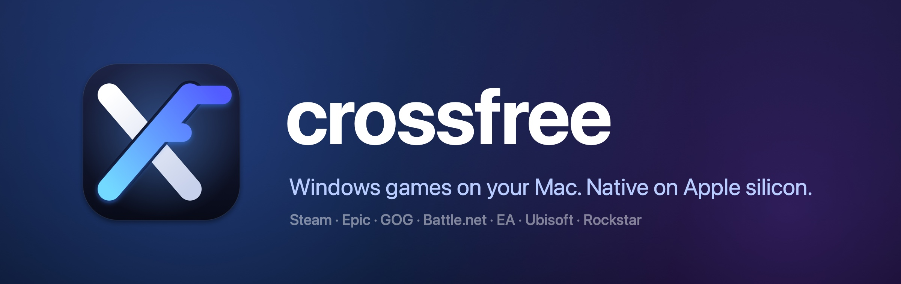
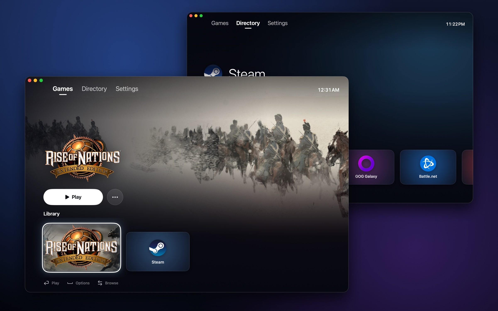
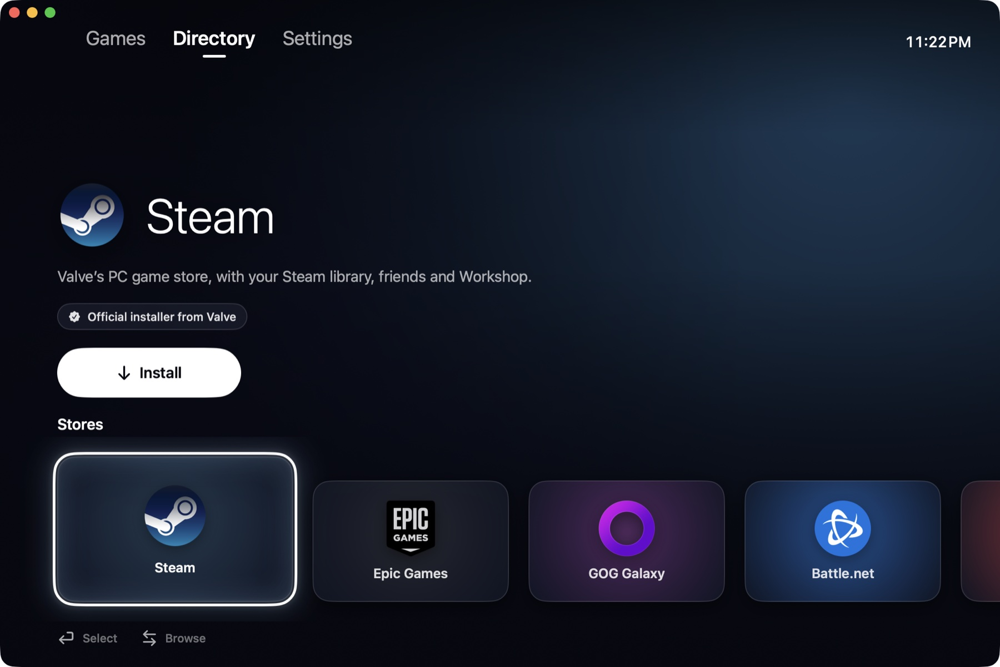
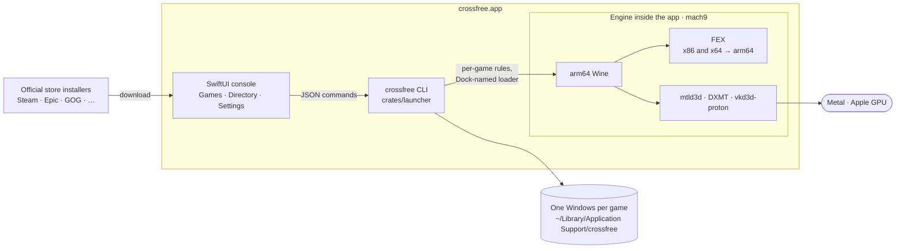
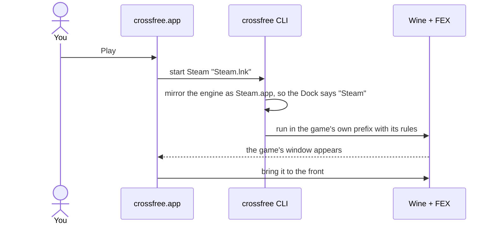
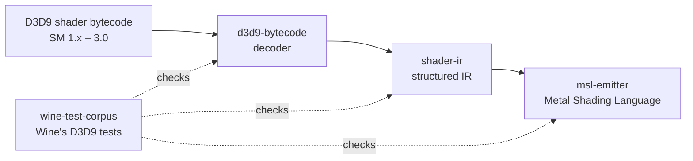

<p align="center">
  
</p>

<p align="center">
  <b>Play Windows games on your Mac.</b><br>
  A free, open-source alternative to CrossOver for Apple silicon: a console-style launcher for
  Steam, Epic Games, GOG and more, running on native arm64 Wine + FEX. No virtual machine, no Rosetta.
</p>

<p align="center">
  <a href="https://lithaxor.github.io/crossfree/"></a>
  <a href="https://github.com/LitHaxor/crossfree/releases/latest"></a>
  <a href="https://github.com/LitHaxor/crossfree/actions/workflows/ci.yml"></a>
  
  <a href="LICENSE"></a>
</p>



## Why crossfree

- **Native on Apple silicon.** arm64 Wine runs Windows on your Mac directly, and [FEX](https://github.com/FEX-Emu/FEX)
  translates x86 and x64 game code to arm64. Direct3D 9 runs on Metal through mtld3d, Direct3D 10 and 11
  through DXMT, Direct3D 12 through vkd3d-proton.
- **Every store, one click.** The Directory installs Steam, Epic Games, GOG Galaxy, Battle.net, the EA app,
  Ubisoft Connect and the Rockstar Games Launcher from their official installers.
- **A console on your Mac.** Full-window game art from your Steam library, Play and Resume, smooth spring
  animations, and controller support (PlayStation, Xbox and other MFi pads) next to the keyboard.
- **Feels like a Mac app.** Games appear in the Dock under their own names with their own icons, and crossfree
  knows which games are running.
- **Free and open source**, under the MIT license.

## Download

1. Download the latest **`crossfree-<version>.dmg`** from [Releases](https://github.com/LitHaxor/crossfree/releases/latest),
   open it and drag **crossfree** to **Applications**.
2. crossfree is not notarized yet, so macOS blocks a downloaded copy. Clear the quarantine once:
   ```sh
   xattr -dr com.apple.quarantine /Applications/crossfree.app
   ```
3. Open crossfree, go to **Directory** and install a store. Its games appear under **Games**.

**Requirements:** a Mac with Apple silicon (M1 or later) and macOS 26.4 or later.



## How it works



The app never talks to Wine directly. It runs `crossfree`, a small Rust command-line tool, which creates a Windows
environment (a Wine prefix) for each installer, starts programs in it with that game's rules, finds their Start Menu
shortcuts, icons and Steam artwork, and reports back as JSON.



The engine is [mach9](https://github.com/athei/mach9)'s signed, notarized arm64 Wine build, shipped inside the app
exactly as released. crossfree adds the parts you touch: the app, the launcher, per-game rules and the store
directory. The full plan, with its decisions and evidence, is in [`docs/ARCHITECTURE.md`](docs/ARCHITECTURE.md).

### A Direct3D 9 → Metal shader translator

The repository also holds a tested, parked translator for Direct3D 9 shaders, checked against the shaders in Wine's
own D3D9 conformance tests. Every one of them compiles in Metal.



## Build from source

You need Rust 1.89 or later and Swift 6 (Xcode or the Command Line Tools).

```sh
git clone https://github.com/LitHaxor/crossfree && cd crossfree

# The engine: mach9's arm64 Wine + FEX bundle
gh release download v0.2.0 --repo athei/mach9 --pattern 'wine-v0.2.0-macos-arm64.tar.xz'
tar xJf wine-v0.2.0-macos-arm64.tar.xz

CROSSFREE_ENGINE="$PWD/wine" ./tools/build-app.sh   # → target/crossfree.app
open target/crossfree.app
```

Tests, formatting and lints, as CI runs them:

```sh
cargo test --workspace
cargo fmt --all -- --check && cargo clippy --workspace --all-targets -- -D warnings
swift test --package-path app
swift format lint --strict -r app/Sources app/Tests
```

| Path | What |
|---|---|
| [`app/`](app) | The macOS app (SwiftUI) |
| [`crates/launcher/`](crates/launcher) | The `crossfree` CLI: engine, prefixes, launching, shortcuts, icons, Steam artwork, Dock names |
| [`crates/d3d9-bytecode/`](crates/d3d9-bytecode), [`shader-ir/`](crates/shader-ir), [`msl-emitter/`](crates/msl-emitter) | The D3D9 → Metal shader translator |
| [`crates/wine-test-corpus/`](crates/wine-test-corpus) | Wine's D3D9 test shaders, for the translator's tests |
| [`tools/`](tools) | App packaging, the app icon, store logos |
| [`docs/`](docs) | Architecture and spikes |

Contributions are welcome. [`AGENTS.md`](AGENTS.md) describes the conventions, for people and coding agents alike.

## Status

crossfree is young. Steam installs, signs in and downloads games; other stores install from the Directory. Next up are
saved per-game profiles and a compatibility database. Releases are built by
[GitHub Actions](.github/workflows/release.yml) from tags.

## Credits

crossfree stands on [mach9](https://github.com/athei/mach9) (zlib), [Wine](https://www.winehq.org) (LGPL),
[FEX](https://github.com/FEX-Emu/FEX) (MIT), mtld3d, [DXMT](https://github.com/3Shain/dxmt) and
[vkd3d-proton](https://github.com/HansKristian-Work/vkd3d-proton), each under its own license. 

Store names and logos belong to their owners. crossfree is not affiliated with CodeWeavers, Valve, Epic Games, GOG,
Blizzard, Electronic Arts, Ubisoft, Rockstar Games or Microsoft.

## License

[MIT](LICENSE) © 2026 LitHaxor
